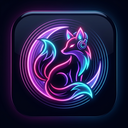

<div align="center">
  <p>
    <strong>🇬🇧 English</strong> &nbsp;|&nbsp; <a href="README.pl.md">🇵🇱 Polski</a>
  </p>
  
  <h1>Auralune (Kitsune Player) 🌸🎧</h1>
  <p><strong>A native, deeply customizable Linux music player marrying the ergonomics of Poweramp, the flexibility of foobar2000, swappable real-time DSP engines, and an anime glassmorphism aesthetic.</strong></p>

  <p>
    <a href="https://github.com/Das-Letzte-Kemonomimi/Aura-Lune/releases/tag/v2.0.0"></a>
    <a href="LICENSE"></a>
    <a href="#"></a>
    <a href="#"></a>
    <a href="#"></a>
  </p>
</div>

---

## 🌟 About The Project

**Auralune** (working title *Kitsune Player*) is a modern desktop music player built natively for Linux. Designed for audiophiles, sound-sculpting tinkerers, and enthusiasts of refined anime aesthetics and acrylic glassmorphism.

The application pairs a modular **Rust** workspace and **Tauri 2** host with a responsive **React 19 + TypeScript + Tailwind CSS v4 + Vite** frontend, strictly isolating the real-time **GStreamer / PipeWire** audio thread from the UI, **SQLite** database, and network I/O. Available in **5 languages** (English, Polish, German, Finnish, Latin), while treating your audio files as **strictly read-only** outside explicit tag edits or file renames.

---

## ✨ Key Features

### 🎛️ Advanced Real-Time DSP Processor & Sound Sculpting
- **Independent Parameter Control**:
  - **Tempo**: Adjust tempo smoothly from `0.15x` to `4.00x` without altering pitch.
  - **Pitch**: Transpose key in semitones (`-12.0 st` to `+12.0 st`) with cent-level precision.
  - **Playback Rate**: Simultaneous analog-style tempo and pitch scaling, plus **Tap Tempo** BPM detection & live DSP sync.
- **Swappable DSP Engines**:
  - **Direct Bit-Perfect Bypass**: Zero-overhead passthrough when DSP and EQ are off.
  - **Rubber Band**: Studio-grade phase vocoder, vocal formant preservation, high-fidelity time stretching.
  - **SoundTouch**: Ultra-low CPU overhead, instant real-time responsiveness.
- **On-The-Fly Seamless Switching**: Switch DSP engines and presets live during playback without dropouts, underruns, or clicks, with global, per-album, or per-track preset recall.
- **Equalization, AutoEQ & Dynamics**:
  - **10-Band Graphic EQ** (`31 Hz`–`16 kHz`) and **32-Band Parametric EQ Studio** with interactive frequency curve and **EqualizerAPO / AutoEQ** `.txt` import/export.
  - **160+ Built-in AutoEQ Headphone Profiles** (Harman Target, Sennheiser, Sony, Moondrop, Beyerdynamic, HiFiMAN, and more).
  - **Dynamics Studio** (Compressor, Tube/Tape/Overdrive Saturator, True-Peak Limiter), **Mid-Side Stereo Widener**, **BS2B Crossfeed**, **Freeverb Spatial Reverb**, and **ReplayGain 2.0** (Track/Album + built-in scanner).
- **DJ Mixing & Harmonic Auto-DJ**: Beat-matched equal-power crossfades, **Camelot Wheel** harmonic compatibility assistant, and **Smart Auto-DJ / Infinity Queue**.

### 🔊 Pro Audio Architecture & Linux Native Integration
- **PipeWire & GStreamer**: Direct low-latency output to PipeWire with adaptive ring buffering, ALSA/PulseAudio fallback, interactive **Audio Path Inspector**, **Linux Audio Health Check**, and **Smart Silence Trimming**.
- **Lossless FLAC & Hi-Res Support**: Gapless decoding and stutter-free playback of 24-bit/96kHz+ FLAC, WAV, Opus, Ogg Vorbis, MP3, and AAC/M4A.
- **Bluetooth Pro Audio Codecs**: Dynamic codec negotiation for high-definition wireless listening (`LDAC`, `aptX HD`, `AAC`, `SBC-XQ`).
- **Desktop, Ricing & Scrobbling**:
  - **MPRIS v2 (D-Bus)** integration and **System Tray** controls for KDE Plasma, GNOME, hardware media keys, and bars.
  - **Waybar / Hyprland / Sway Ricing IPC**: Atomic status JSON (`$XDG_RUNTIME_DIR/auralune/auralune.json`) plus FIFO & Unix socket control channels.
  - **Discord Rich Presence**, **Last.fm & ListenBrainz** scrobbling, **Two Volume Modes** (Instant / Smooth fade), and **Profile Portability Backup**.
- **In-App Updater**: Managed AppImage updates with separate `stable` and `dev` channels, release notes preview, and SHA-256 verification.

### 🌸 Anime Aesthetics, Visualizers & Localization
- **Acrylic Glassmorphism & Themes**: Translucent interface with adjustable blur and overlay tint, custom anime wallpapers with contrast protection, optional **Anime Ambience FX** (sakura petals, fireflies, rain, snow), switchable icon styles (*Classic* / *Lineout Neon*), **UI Scale** (`100%`–`130%` / Ultra Wide), and JSON theme import/export.
- **Interactive Visualizations**:
  - **4-Style Waveform Canvas**: Drag scrubbing with live time preview, smooth click-free seeking (shared with all progress sliders), and `[A]`/`[B]` loop & cue markers.
  - **16-Band FFT Spectrum & Lissajous Stereo Vectorscope**, **Analog Stereo VU-Meter**, plus interactive **Hi-Fi Vinyl Turntable** and **Retro Tape Deck** with Lo-Fi Vinyl/Tape noise simulator.
- **Multilingual UI**: Complete localization in **English (`en`)**, **Polski (`pl`)**, **Deutsch (`de`)**, **Suomi (`fi`)**, and **Latina (`la`)**.

### 📚 Library, Tagging, Lyrics, Radio & Export
- **SQLite Library & Organization**: Fast incremental scanning (`sqlx` WAL), **foobar2000-style 3-column Facets** (Genre → Artist → Album), Smart Playlists, Duplicate Finder, M3U/M3U8 playlists, CUE sheets, and file-manager Drag & Drop.
- **Metadata & File Tools**: **foobar2000-style Tag Editor**, **MusicBrainz** lookup, **Chromaprint / AcoustID** acoustic fingerprinting, **Cover Art Archive** picker, and pattern-based **File Renamer**.
- **Synchronized LRC Lyrics**: Integrated viewer with live **LRCLIB** fetching, built-in timestamp editor, **Japanese Romaji** engine (*Original* / *Romaji* / *Dual*), and **Always-on-Top Desktop Lyrics Overlay**.
- **Radio, Soundscapes & Transcoder**: Web Radio (Anime/J-Pop/Lo-Fi + custom streams), **Soundscape Ambient Mixer**, background **Transcoder** (Opus, FLAC, WAV with optional baked DSP effects & A-B crop), URL importer (`yt-dlp`), and **Download Hub**.

### 🎼 Music Analysis Studio
- **Chord Progression & Beat Grid**: Chronological chord detection synchronized to the beat grid; dynamic transposition with Pitch Shift; ChordPro, text, and JSON export; manual chord editing.
- **Polyphonic Note Transcription & Piano-Roll**: Rebuilt crisp HTML5 canvas piano-roll with follow/free navigation modes, time/row zoom, beat grid, live note highlights, interactive minimap, and Standard MIDI File (`.mid`) export.
- **Stem Separation & Stem Mixer**: 4-stem isolation (`Vocals`, `Drums`, `Bass`, `Other`) via mathematical STFT/HPSS or deep learning (**HTDemucs v4**); sample-accurate GStreamer `audiomixer` feeding the core DSP chain with individual solo/mute and Karaoke / Minus-One toggles.
- **Moises-Style Stem Projects Studio**: Fine-grained, multi-track cascaded stem projects (lead/backing vocals, drum pieces, bass, acoustic/electric guitars, piano/synths, orchestral strings/brass) with exact residual preservation ($\sum \text{stems} = \text{original} \pm 10^{-6}$); studio mixing console with 0–100% faders (`75%` default = `0 dB` unity gain, `+6 dB` headroom boost), instant presets, named mix recall in SQLite, FLAC/WAV mixdown, and ZIP project export.
- **Model Manager**: Offline-first, zero-telemetry AI model manager in Settings with SHA-256 integrity verification and GPU auto-detection (NVIDIA CUDA, AMD ROCm/Vulkan).

### ⏱️ Player Tools
- **A-B Looper**: Seamlessly loop any track segment with millisecond precision.
- **Playback Bookmarks**: Save multiple named cue positions in tracks for 1-click resumption.
- **Flexible Sleep Timer**: Timed shutdown with quick presets, interactive slider, manual minute entry (`1–720 min`), and gentle volume fade-out.
- **Mini-Player (PiP) & Big Screen Mode (`F11`)**: Floating Picture-in-Picture window and fullscreen theater view with artwork, waveform, VU-Meter/FFT, and active chord badges.
- **Command Palette (`Ctrl+K`) & Auralune Recap**: Instant keyboard navigation and weekly/monthly/yearly listening statistics.

---

## 💖 Author & Related Projects

| Project | Description | Link |
| :--- | :--- | :--- |
| **🎵 Das Letzte Kemonomimi** | Original music by the creator of Auralune (including the official starter track *“Skrzydła Białe”*, folk-rock / anime soundtrack). Listen and support independent music! | [**Visit Bandcamp**](https://dasletztekemonomimi.bandcamp.com/) |
| **🧠 Sorta (AuDHD Focus)** | Web application designed specifically for people with **AuDHD & ADHD**. Breaks through executive dysfunction and task paralysis into stress-free micro-steps, declutters mental chaos, and provides gentle, empathetic accountability without overwhelm. | [**Try Sorta App**](https://sortaofficial.lovable.app/) |

---

## 📦 Installation & Usage

### 1. One-line Universal Installation (Any Linux Distribution)
Install or update Auralune with a single command (rootless, installs under `~/.local`):
```bash
curl -fsSL https://raw.githubusercontent.com/Das-Letzte-Kemonomimi/Aura-Lune/main/install.sh | bash
```
The installer downloads the latest AppImage, installs icons, desktop entry (`auralune.desktop`), and a smart launcher with automatic FUSE 2 fallback and host GStreamer plugin detection (`auralune --uninstall` removes it cleanly without touching your library or settings).

<details>
<summary>🧪 <sub>Optional: Rolling Development Build (Pre-releases)</sub></summary>

> [!NOTE]
> Development builds install side-by-side into `~/.local/bin/auralune-dev` with their own icon and profile directory without overwriting your stable config or library. Intended for testers and contributors.
> ```bash
> curl -fsSL https://raw.githubusercontent.com/Das-Letzte-Kemonomimi/Aura-Lune/dev/install.sh | bash -s -- --dev
> ```
> Standalone development packages are published on every `dev` push under **[GitHub Pre-releases (tag: `dev-build`)](https://github.com/Das-Letzte-Kemonomimi/Aura-Lune/releases/tag/dev-build)**.
</details>

### 2. Standalone Packages (AppImage & `.deb`)
Download ready-to-run packages and `SHA256SUMS` from **[GitHub Releases](https://github.com/Das-Letzte-Kemonomimi/Aura-Lune/releases/latest)** (or rolling development AppImages from **[GitHub Pre-releases (tag: `dev-build`)](https://github.com/Das-Letzte-Kemonomimi/Aura-Lune/releases/tag/dev-build)**):
- **Any Linux distribution (AppImage — Arch, Fedora / Bazzite, Ubuntu, Steam Deck, …)**:
  ```bash
  chmod +x Auralune_*_amd64.AppImage
  ./Auralune_*_amd64.AppImage
  ```
- **Debian / Ubuntu / Linux Mint / Pop!_OS (`.deb`)**:
  ```bash
  sudo apt install ./auralune_*_amd64.deb
  ```

### 3. Arch Linux / EndeavourOS / CachyOS (AUR)
```bash
# Using your preferred AUR helper:
yay -S auralune-bin
# or
paru -S auralune-bin
```

---

## 🛠️ Building from Source (Development)

Requires **Node.js 22 LTS** (≥ 22.20, `.nvmrc`, **npm only**) and **Rust stable** (`rust-toolchain.toml` with `rustfmt` and `clippy`).

### System Prerequisites (Arch Linux)
```bash
sudo pacman -Syu --needed base-devel pkgconf openssl glib2 gtk3 webkit2gtk-4.1 \
  libappindicator-gtk3 librsvg gstreamer gst-plugins-base gst-plugins-good \
  gst-plugins-bad gst-plugins-ugly gst-libav gst-plugin-pipewire \
  rubberband soundtouch alsa-lib
```
*(Ubuntu/Debian, Fedora/RHEL, and openSUSE Tumbleweed package lists are in [`DEVELOPMENT.md`](DEVELOPMENT.md#1-system-prerequisites).)*

### Step by Step
```bash
# 1. Clone the repository:
git clone https://github.com/Das-Letzte-Kemonomimi/Aura-Lune.git
cd Aura-Lune

# 2. Install frontend dependencies:
npm install

# 3. Restore shared AI agent skills (if missing):
npm run skills:check || npm run skills:install

# 4. Launch the desktop app in development mode (Tauri 2 + Vite HMR):
npm run tauri dev
```

### Building Release Bundles (AppImage & `.deb`)
```bash
npm run tauri build -- --bundles appimage,deb
```
Generated bundles are placed under `target/release/bundle/appimage/` and `target/release/bundle/deb/`.

---

## 🧪 Testing & Code Quality

Auralune includes a single **7-stage CI-parity verification runner** (`./tests/run_all_tests.sh`) alongside targeted checks:

```bash
# Full CI-parity suite (rustfmt -> oxlint + Vitest -> tsc + vite build -> clippy -> cargo test -> smoke test -> bash -n)
./tests/run_all_tests.sh --fix

# Fast mode (format, lint, typecheck, clippy — skips long audio playback tests)
./tests/run_all_tests.sh --fast

# Individual Rust workspace checks
cargo fmt --all --check
cargo clippy --workspace --all-targets --all-features -- -D warnings
cargo test --workspace -- --test-threads=1

# Individual frontend, script, and contract checks
npm run lint                  # oxlint
npm run typecheck             # tsc -b
npm test                      # Vitest (frontend + scripts/ tests)
npm run build                 # tsc -b && vite build
npm run gen:commands          # Regenerate src/api/commands.generated.ts after IPC changes
npm run changelog:validate    # Validate src/data/changelog.json schema & 5-locale parity
npm run skills:check          # Verify Claude Code & Antigravity shared skills
```

---

## 📐 Documentation, Pipelines & Architecture (ADR)

- **Setup, Toolchain & Build Guide**: [`DEVELOPMENT.md`](DEVELOPMENT.md)
- **Changelog Rules & Writing Guide**: [`CHANGELOG.md`](CHANGELOG.md) (entries live in [`src/data/changelog.json`](src/data/changelog.json) and inside **Settings → Updates & Changelog**)
- **Feature Matrix**: [`docs/FEATURE_MATRIX.md`](docs/FEATURE_MATRIX.md)
- **Developer Documentation Index**: [`docs/developer/README.md`](docs/developer/README.md) (`architecture-guide.md`, `rust-architecture.md`, `tauri-commands.md`, `frontend-architecture.md`, `testing.md`)
- **Automated Pipelines**: [`docs/developer/agent-pipelines.md`](docs/developer/agent-pipelines.md) (daily workflows) & [`docs/developer/release-pipeline.md`](docs/developer/release-pipeline.md) (`npm run release:prepare` + push-driven releases; overview in [`docs/RELEASING.md`](docs/RELEASING.md))
- **System Architecture Guide**: [`docs/architecture.md`](docs/architecture.md)
- **Architecture Decision Records**:
  - [ADR 0001: GStreamer Pipeline Integration & DSP Engines](docs/adr/0001-dsp-engine-integration.md)
  - [ADR 0002: Bluetooth Pro Audio Codecs & File Safety](docs/adr/0002-pro-audio-bluetooth-codecs-and-file-safety.md)
  - [ADR 0003: Library Scanner & SQLite Schema](docs/adr/0003-library-scanner-and-sqlite-schema.md)
  - [ADR 0004: Rubber Band & SoundTouch DSP Adapters](docs/adr/0004-rubberband-soundtouch-dsp-engines.md)
  - [ADR 0005: MPRIS D-Bus Desktop Integration](docs/adr/0005-mpris-dbus-desktop-integration.md)
  - [ADR 0006: Anime Theming Engine & Secure Backgrounds](docs/adr/0006-anime-theme-engine-and-custom-backgrounds.md)
  - [ADR 0007: MusicBrainz & Cover Art Archive](docs/adr/0007-musicbrainz-and-cover-art-archive.md)
  - [ADR 0008: Playback Queue & Playlist Management](docs/adr/0008-playback-queue-and-playlists.md)
  - [ADR 0009: Arch Linux Packaging (PKGBUILD) & AppImage](docs/adr/0009-packaging-arch-pkgbuild-and-appimage.md)
  - [ADR 0010: Graphic Equalizer & FFT Visualizer](docs/adr/0010-equalizer-and-spectrum-visualizer.md)
  - [ADR 0011: DSP Stability, Underrun Resilience & Unicode Safety](docs/adr/0011-dsp-stability-reverb-unicode-safety-and-recap.md)
  - [ADR 0012: Music Analysis (Chords, Notes & Stem Separation)](docs/adr/0012-music-analysis-chords-notes-and-stem-separation.md)
  - [ADR 0013: Moises-Style Stem Projects & Cascaded Separation](docs/adr/0013-stem-projects-fine-grained-cascaded-separation.md)

---

## 📜 License

This project is licensed under the terms of the **GNU General Public License v3.0 or later** ([`LICENSE`](LICENSE)), in accordance with the licensing requirements of linked DSP components (Rubber Band under GPL-2.0-or-later, SoundTouch under LGPL-2.1-or-later).

**Author**: Das Letzte Kemonomimi 🌸  
*Crafted with passion for music, high-resolution audio, and free open-source software.*
