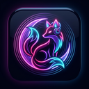

<div align="center">
  <p>
    <a href="README.md">🇬🇧 English</a> &nbsp;|&nbsp; <strong>🇵🇱 Polski</strong>
  </p>
  
  <h1>Auralune (Kitsune Player) 🌸🎧</h1>
  <p><strong>Natywny, wysoce konfigurowalny odtwarzacz muzyki dla Linuksa łączący wygodę Powerampa, elastyczność foobar2000, wymienny silnik DSP w czasie rzeczywistym i estetykę anime.</strong></p>

  <p>
    <a href="https://github.com/Das-Letzte-Kemonomimi/Aura-Lune/releases/tag/v0.3.0"></a>
    <a href="LICENSE"></a>
    <a href="#"></a>
    <a href="#"></a>
    <a href="#"></a>
  </p>
</div>

---

## 🌟 O projekcie

**Auralune** (roboczo *Kitsune Player*) to nowoczesny desktopowy odtwarzacz muzyczny dla Linuksa. Został stworzony z myślą o audiofilach, entuzjastach precyzyjnego przetwarzania dźwięku oraz osobach ceniących głęboką personalizację wizualną w stylu anime/glassmorphism. 

Aplikacja łączy zaawansowany potok audio w języku **Rust** z responsywnym frontendem **React + TypeScript + Vite**, izolując ścieżkę audio czasu rzeczywistego od interfejsu użytkownika.

---

## ✨ Główne funkcjonalności

### 🎛️ Zaawansowany procesor DSP czasu rzeczywistego
- **Niezależne sterowanie parametrami**:
  - **Tempo**: zmiana tempa od 0.15x do 4.00x bez zmiany wysokości dźwięku.
  - **Pitch**: transpozycja wysokości dźwięku w półtonach (`-12.0 st` do `+12.0 st`) z precyzją co do centa.
  - **Playback Rate**: jednoczesna analogowa zmiana tempa i wysokości.
- **Wymienne silniki DSP**:
  - **Rubber Band**: jakość studyjna, zachowanie formantów wokalnych, precyzyjne time-stretching.
  - **SoundTouch**: ultra-niski narzut CPU, błyskawiczna reakcja w czasie rzeczywistym.
- **Płynne przełączanie w locie**: dynamiczna zmiana silnika bez zatrzymywania muzyki i bez trzasków.
- **Presety DSP**: zapisywanie i wczytywanie ustawień korekcji wysokości i tempa.

### 🔊 Architektura Pro Audio & Linux Native
- **PipeWire & GStreamer**: bezpośrednie, niskolatencyjne wyjście do serwera PipeWire z buforem adaptacyjnym oraz bezpiecznym fallbackiem ALSA/PulseAudio.
- **Bezstratny FLAC & Hi-Res**: stabilne odtwarzanie formatów bezstratnych (FLAC 24-bit/96kHz+, WAV, Opus, Ogg Vorbis, MP3, AAC/M4A).
- **Bluetooth Pro Audio Codecs**: dynamiczny wybór kodeków wysokiej rozdzielczości (LDAC, aptX HD, AAC, SBC-XQ).
- **Integracja MPRIS (D-Bus)**: pełne wsparcie dla sterowania z poziomu panelu KDE Plasma, GNOME, pasków Waybar/Polybar oraz klawiszy multimedialnych.

### 🌸 Wizualna estetyka Anime & System Motywów
- **Akrylowy Glassmorphism**: półprzezroczysty interfejs z regulacją nasycenia rozmycia tła (`blur`) i przyciemnienia nakładki (`overlay`).
- **Własne tła anime**: możliwość ustawienia dowolnej tapety lokalnej bez ryzyka utraty czytelności tekstu.
- **Dynamiczne neonowe suwaki**: gradientowe wypełnienie paska odtwarzania (`accent-pink` → `accent-purple`) wizualizujące postęp utworu.
- **Efekty cząsteczkowe (Anime Ambience FX)**: opcjonalne animowane cząsteczki w tle (spadające płatki sakury, świetliki, deszcz, śnieg).

### 📊 Wizualizacja, Akustyka & Teksty
- **10-pasmowy korektor graficzny (EQ)**: precyzyjne dopasowanie pasm od 31 Hz do 16 kHz.
- **Spektrogram FFT czasu rzeczywistego**: 16-słupkowa animowana wizualizacja widma częstotliwości audio.
- **Detekcja Key & BPM**: akustyczna analiza tonacji (koło Camelot / Major & Minor) oraz tempa utworów.
- **Interaktywny Waveform Canvas**: generowanie i wizualizacja przebiegu falowego utworu z możliwością precyzyjnego przewijania.
- **Zsynchronizowane teksty piosenek (LRC)**: wbudowana przeglądarka z autoscrollem i wyróżnianiem bieżącego wersu.

### ⏱️ Narzędzia Odtwarzacza
- **Pętla A-B**: powtarzanie dowolnego fragmentu utworu z dokładnością do milisekund.
- **Zakładki odtwarzania (Bookmarks)**: zapisywanie dokładnej pozycji w utworze z możliwością skoku 1-kliknięciem.
- **Elastyczny Sleep Timer**: wyłącznik czasowy z szybkimi presetami, suwakiem, ręcznym wpisywaniem dowolnej liczby minut (1–720 min) oraz łagodnym wygaszaniem głośności (fade-out).
- **Mini-Player (PiP)**: kompaktowy, pływający odtwarzacz w trybie Picture-in-Picture.
- **Tryb kinowy (Big Screen)**: pełnoekranowy widok z powiększoną okładką, waveformem i subtelnymi wskaźnikami.

---

## 💖 Autorka & Projekty Pokrewne

| Projekt | Opis | Odnośnik |
| :--- | :--- | :--- |
| **🎵 Das Letzte Kemonomimi** | Autorska muzyka twórczyni Auralune (w tym oficjalny utwór testowy *„Skrzydła Białe”*, folk-rock / anime soundtrack). Posłuchaj wydań i wesprzyj twórczość! | [**Odwiedź Bandcamp**](https://dasletztekemonomimi.bandcamp.com/) |
| **🧠 Sorta (AuDHD Focus)** | Aplikacja webowa stworzona z myślą o osobach z **AuDHD & ADHD**. Pomaga rozbijać paraliż zadaniowy na bezstresowe mikrokroki, redukuje chaos myśli i wspiera z empatią bez przytłoczenia. | [**Wypróbuj aplikację Sorta**](https://sortaofficial.lovable.app/) |

---

## 📦 Instalacja i Uruchomienie

### 1. Gotowa paczka AppImage (Wszystkie dystrybucje Linuksa)
Pobierz najnowszy plik z sekcji **[GitHub Releases](https://github.com/Das-Letzte-Kemonomimi/Aura-Lune/releases/latest)**:
```bash
chmod +x Auralune_0.3.0_amd64.AppImage
./Auralune_0.3.0_amd64.AppImage
```

### 2. Arch Linux / EndeavourOS / CachyOS (AUR)
```bash
# Za pomocą dowolnego AUR helpera:
yay -S auralune-bin
# lub
paru -S auralune-bin
```

---

## 🛠️ Budowanie ze źródeł (Development)

### Wymagania systemowe (Arch Linux):
```bash
sudo pacman -S --needed base-devel git rustup nodejs npm \
  gstreamer gst-plugins-base gst-plugins-good gst-plugins-bad gst-plugin-pipewire \
  pipewire soundtouch rubberband sqlite webkit2gtk-4.1 gtk3
```

### Krok po kroku:
```bash
# 1. Klonowanie repozytorium:
git clone https://github.com/Das-Letzte-Kemonomimi/Aura-Lune.git
cd Aura-Lune

# 2. Instalacja zależności frontendu:
cd apps/desktop
npm install
cd ../..

# 3. Uruchomienie w trybie deweloperskim (Tauri 2 hot-reload):
cd apps/desktop
npm run tauri dev
```

### Budowanie paczki AppImage:
```bash
cd apps/desktop
npm run tauri -- build --bundles appimage
```
Wygenerowana paczka znajdzie się w: `target/release/bundle/appimage/`.

---

## 🧪 Testy i jakość kodu

Auralune stosuje rygorystyczną piramidę testów jakościowych i wydajnościowych:

```bash
# 1. Automatyczny audyt pakietu i test dymny (Smoke Test):
./packaging/smoke-test.sh

# 2. Testy jednostkowe i integracyjne backendu Rust:
cargo test --all-targets --all-features -- --test-threads=1

# 3. Sprawdzenie formatowania i lintera (Clippy):
cargo fmt --check
cargo clippy --all-targets --all-features -- -D warnings

# 4. Sprawdzenie typów TypeScript i budowanie frontendu:
cd apps/desktop && npm run build
```

---

## 📐 Architektura i Decyzje Projektowe (ADR)

Szczegółowy opis decyzji inżynieryjnych znajduje się w katalogu `docs/`:
- **Główna architektura systemu**: [`docs/architecture.md`](docs/architecture.md)
- **Katalog decyzji architektonicznych**:
  - [ADR 0001: Integracja potoku GStreamer i silników DSP](docs/adr/0001-dsp-engine-integration.md)
  - [ADR 0002: Kodeki Bluetooth Pro Audio i bezpieczeństwo plików](docs/adr/0002-pro-audio-bluetooth-codecs-and-file-safety.md)
  - [ADR 0003: Skaner biblioteki i schemat SQLite](docs/adr/0003-library-scanner-and-sqlite-schema.md)
  - [ADR 0004: Adaptery silników Rubber Band i SoundTouch](docs/adr/0004-rubberband-soundtouch-dsp-engines.md)
  - [ADR 0005: Integracja systemowa MPRIS przez D-Bus](docs/adr/0005-mpris-dbus-desktop-integration.md)
  - [ADR 0006: System motywów anime i bezpieczne tła](docs/adr/0006-anime-theme-engine-and-custom-backgrounds.md)
  - [ADR 0007: MusicBrainz oraz Cover Art Archive](docs/adr/0007-musicbrainz-and-cover-art-archive.md)
  - [ADR 0008: Kolejka odtwarzania i zarządzanie playlistami](docs/adr/0008-playback-queue-and-playlists.md)
  - [ADR 0009: Pakietowanie Arch Linux (PKGBUILD) i AppImage](docs/adr/0009-packaging-arch-pkgbuild-and-appimage.md)
  - [ADR 0010: Korektor graficzny i wizualizator FFT](docs/adr/0010-equalizer-and-spectrum-visualizer.md)
  - [ADR 0011: Stabilność DSP, odporność na underrun i Unicode](docs/adr/0011-dsp-stability-reverb-unicode-safety-and-recap.md)

---

## 📜 Licencja

Projekt udostępniany na warunkach **GNU General Public License v3.0 or later** ([`LICENSE`](LICENSE)).  
Zgodny z wymogami licencyjnymi włączanych bibliotek DSP (Rubber Band na licencji GPL-2.0-or-later, SoundTouch na LGPL-2.1-or-later).

**Autorka**: Das Letzte Kemonomimi 🌸  
*Stworzone z pasją do muzyki, dźwięku wysokiej rozdzielczości i wolnego oprogramowania.*
