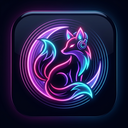

<div align="center">
  <p>
    <a href="README.md">🇬🇧 English</a> &nbsp;|&nbsp; <strong>🇵🇱 Polski</strong>
  </p>
  
  <h1>Auralune (Kitsune Player) 🌸🎧</h1>
  <p><strong>Natywny, wysoce konfigurowalny odtwarzacz muzyki dla Linuksa łączący wygodę Powerampa, elastyczność foobar2000, wymienny silnik DSP w czasie rzeczywistym i estetykę anime.</strong></p>

  <p>
    <a href="https://github.com/Das-Letzte-Kemonomimi/Aura-Lune/releases/tag/v1.1.5"></a>
    <a href="LICENSE"></a>
    <a href="#"></a>
    <a href="#"></a>
    <a href="#"></a>
  </p>
</div>

---

## 🌟 O projekcie

**Auralune** (roboczo *Kitsune Player*) to nowoczesny desktopowy odtwarzacz muzyczny dla Linuksa. Został stworzony z myślą o audiofilach, entuzjastach precyzyjnego przetwarzania dźwięku oraz osobach ceniących głęboką personalizację wizualną w stylu anime/glassmorphism.

Aplikacja łączy modularny workspace **Rust** oraz host **Tauri 2** z responsywnym frontendem **React 19 + TypeScript + Tailwind CSS v4 + Vite**, ściśle izolując wątek audio czasu rzeczywistego (**GStreamer / PipeWire**) od interfejsu, bazy **SQLite** i operacji sieciowych. Interfejs jest dostępny w **5 językach** (polski, angielski, niemiecki, fiński, łacina), a pliki audio użytkownika pozostają **ściśle tylko do odczytu** poza jawną edycją tagów lub zmianą nazwy.

---

## ✨ Główne funkcjonalności

### 🎛️ Zaawansowany procesor DSP czasu rzeczywistego i kształtowanie brzmienia
- **Niezależne sterowanie parametrami**:
  - **Tempo**: zmiana tempa od `0.15x` do `4.00x` bez zmiany wysokości dźwięku.
  - **Pitch**: transpozycja wysokości dźwięku w półtonach (`-12.0 st` do `+12.0 st`) z precyzją co do centa.
  - **Playback Rate**: jednoczesna analogowa zmiana tempa i wysokości oraz **Tap Tempo** z detekcją BPM i synchronizacją DSP na żywo.
- **Wymienne silniki DSP**:
  - **Direct Bit-Perfect Bypass**: bezstratny strumień passthrough przy wyłączonym DSP i EQ.
  - **Rubber Band**: jakość studyjna, zachowanie formantów wokalnych, precyzyjne time-stretching.
  - **SoundTouch**: ultra-niski narzut CPU, błyskawiczna reakcja w czasie rzeczywistym.
- **Płynne przełączanie w locie**: dynamiczna zmiana silnika i presetów bez zatrzymywania muzyki i bez trzasków (presety globalne, per album lub per utwór).
- **Korekcja barwy, AutoEQ i Studio Dynamiki**:
  - **10-pasmowy Korektor Graficzny** (`31 Hz`–`16 kHz`) oraz **32-pasmowy Korektor Parametryczny (PEQ Studio)** z interaktywną krzywą i importem/eksportem **EqualizerAPO / AutoEQ** (`.txt`).
  - **160+ wbudowanych profili słuchawkowych AutoEQ** (Harman Target, Sennheiser, Sony, Moondrop, Beyerdynamic, HiFiMAN i inne).
  - **Studio Dynamiki** (kompresor, saturator lampowy/taśmowy, limiter True-Peak), **Stereo Widener (M/S)**, **Crossfeed (BS2B)**, pogłos **Freeverb** oraz **ReplayGain 2.0** (Track/Album + wbudowany skaner).
- **Miksowanie DJ i Auto-DJ Harmoniczny**: przejścia crossfade dopasowane do bitu, asystent koła **Camelot Wheel** oraz ciągła kolejka **Smart Auto-DJ / Infinity Queue**.

### 🔊 Architektura Pro Audio i integracja z pulpitem Linuksa
- **PipeWire & GStreamer**: bezpośrednie, niskolatencyjne wyjście do PipeWire z buforem adaptacyjnym, fallbackiem ALSA/PulseAudio, interaktywnym **Inspektorem Toru Audio**, **Diagnostyką Systemu Audio** i **przycinaniem ciszy (Silence Trimming)**.
- **Bezstratny FLAC & Hi-Res**: odtwarzanie gapless formatów 24-bit/96kHz+ FLAC, WAV, Opus, Ogg Vorbis, MP3 oraz AAC/M4A.
- **Bluetooth Pro Audio Codecs**: dynamiczny wybór kodeków wysokiej rozdzielczości (`LDAC`, `aptX HD`, `AAC`, `SBC-XQ`).
- **Pulpit, Ricing i Scrobbling**:
  - **MPRIS v2 (D-Bus)** i ikona w **zasobniku systemowym** (KDE Plasma, GNOME, klawisze multimedialne).
  - **Waybar / Hyprland / Sway IPC**: atomowy status JSON (`$XDG_RUNTIME_DIR/auralune/auralune.json`) oraz kanały sterowania FIFO i Unix socket.
  - **Discord Rich Presence**, scrobbling **Last.fm i ListenBrainz**, **dwa tryby regulacji głośności** (Natychmiastowy / Płynny) oraz **kopia zapasowa profilu**.
- **Automatyczne aktualizacje w aplikacji**: zarządzane aktualizacje AppImage z osobnymi kanałami `stable` i `dev`, podglądem zmian oraz weryfikacją sumy SHA-256.

### 🌸 Estetyka Anime, Wizualizacje i Lokalizacja
- **Akrylowy Glassmorphism i Motywy**: półprzezroczysty interfejs z regulacją rozmycia (`blur`) i przyciemnienia, własne tła anime z ochroną kontrastu, efekty **Anime Ambience FX** (sakura, świetliki, deszcz, śnieg), przełącznik stylu ikon (*Classic* / *Lineout Neon*), **skalowanie interfejsu (`100%`–`130%` / Ultra Wide)** oraz import/eksport motywów JSON.
- **Interaktywne wizualizacje**:
  - **4-stylowy Waveform Canvas**: przewijanie przeciąganiem z podglądem czasu na żywo, płynne dwuetapowe przewijanie na wszystkich suwakach oraz znaczniki pętli `[A]`/`[B]` i zakładek.
  - **16-pasmowy spektrogram FFT i wektorowy oscyloskop Lissajous**, **analogowy wskaźnik stereo VU-Meter**, interaktywny **gramofon Hi-Fi** oraz **magnetofon szpulowy** z symulatorem szumu płyty i taśmy Lo-Fi.
- **Pełne wsparcie 5 języków**: **Polski (`pl`)**, **English (`en`)**, **Deutsch (`de`)**, **Suomi (`fi`)** i **Latina (`la`)**.

### 📚 Biblioteka, Tagi, Teksty, Radio i Eksport
- **Biblioteka SQLite i organizacja**: szybkie skanowanie przyrostowe (`sqlx` WAL), **3-kolumnowy panel fasetowy** (Gatunek → Wykonawca → Album), inteligentne playlisty, wyszukiwarka duplikatów, playlisty M3U/M3U8, arkusze CUE oraz natywny Drag & Drop.
- **Metadane i narzędzia plikowe**: **Edytor Tagów** w stylu foobar2000, wyszukiwanie **MusicBrainz**, fingerprinting akustyczny **Chromaprint / AcoustID**, okładki z **Cover Art Archive** i wzorcowy **Renamer Plików**.
- **Zsynchronizowane teksty LRC**: pobieranie z **LRCLIB**, edytor znaczników czasu, konwersja **japońskiego Romaji** (*Oryginał* / *Romaji* / *Dual*) oraz **pływający tekst na pulpicie**.
- **Radio, Pejzaże i Transkoder**: stacje Web Radio (Anime/J-Pop/Lo-Fi + własne strumienie), **Generator pejzaży dźwiękowych**, asynchroniczny **Transkoder** (Opus, FLAC, WAV z opcją wypalenia DSP i przycięcia A-B), importer URL (`yt-dlp`) oraz **Centrum Pobierania**.

### 🎼 Studio Analizy Muzycznej
- **Progresja Akordów & Siatka Rytmiczna**: chronologiczna detekcja akordów na osi czasu zsynchronizowana z beat gridem; dynamiczna transpozycja przy Pitch Shifcie; eksport do ChordPro, tekstu i JSON; ręczna edycja akordów.
- **Polifoniczna Transkrypcja Nut & Piano-Roll**: odświeżony widok HTML5 Canvas z trybem podążania i swobodnym, przybliżaniem czasu/wysokości nut, siatką taktów, podświetlaniem aktywnych klawiszy, klikalną minimapą i eksportem do Standard MIDI (`.mid`).
- **Separacja Ścieżek & Mikser Stemów**: podział na 4 stemy (`Vocals`, `Drums`, `Bass`, `Other`) silnikiem STFT/HPSS lub modelem głębokiego uczenia (**HTDemucs v4**); próbkowo zgodny mikser GStreamer `audiomixer` podłączony pod główny tor DSP z funkcjami Solo/Mute i trybami Karaoke / Minus-One.
- **Moises-Style Stem Projects Studio**: tworzenie zaawansowanych projektów stemów (wokal główny/chórki, składowe perkusji, gitary akustyczne/elektryczne, fortepian/pady, smyczki/dęte) z zachowaniem składnika resztkowego ($\sum \text{stemy} = \text{oryginał} \pm 10^{-6}$); studyjny mikser z suwakami 0–100% (`75%` domyślnie = `0 dB` unity gain, `+6 dB` headroom boost), natychmiastowe presety, zapisywane miksy w SQLite, zgrywanie do FLAC/WAV oraz eksport do archiwum ZIP.
- **Menedżer Modeli AI (Model Manager)**: lokalny, pozbawiony telemetrii menedżer modeli w Ustawieniach z weryfikacją sum kontrolnych SHA-256 i autodetekcją GPU (NVIDIA CUDA, AMD ROCm/Vulkan).

### ⏱️ Narzędzia Odtwarzacza
- **Pętla A-B**: powtarzanie dowolnego fragmentu utworu z dokładnością do milisekund.
- **Zakładki odtwarzania (Bookmarks)**: zapisywanie nazwanych pozycji w utworze z możliwością skoku 1-kliknięciem.
- **Elastyczny Sleep Timer**: wyłącznik czasowy z szybkimi presetami, suwakiem, ręcznym wpisywaniem minut (`1–720 min`) oraz łagodnym wygaszaniem głośności.
- **Mini-Player (PiP) i Tryb kinowy (`F11`)**: pływające okno Picture-in-Picture oraz widok pełnoekranowy z okładką, waveformem, wskaźnikiem VU-Meter/FFT i plakietką akordu.
- **Paleta Komend (`Ctrl+K`) i Auralune Recap**: błyskawiczna nawigacja z klawiatury oraz tygodniowe, miesięczne i roczne statystyki odsłuchów.

---

## 💖 Autorka & Projekty Pokrewne

| Projekt | Opis | Odnośnik |
| :--- | :--- | :--- |
| **🎵 Das Letzte Kemonomimi** | Autorska muzyka twórczyni Auralune (w tym oficjalny utwór startowy *„Skrzydła Białe”*, folk-rock / anime soundtrack). Posłuchaj wydań i wesprzyj twórczość! | [**Odwiedź Bandcamp**](https://dasletztekemonomimi.bandcamp.com/) |
| **🧠 Sorta (AuDHD Focus)** | Aplikacja webowa stworzona z myślą o osobach z **AuDHD & ADHD**. Pomaga rozbijać paraliż zadaniowy na bezstresowe mikrokroki, redukuje chaos myśli i wspiera z empatią bez przytłoczenia. | [**Wypróbuj aplikację Sorta**](https://sortaofficial.lovable.app/) |

---

## 📦 Instalacja i Uruchomienie

### 1. Szybka instalacja jednym poleceniem (Wszystkie dystrybucje Linuksa)
Możesz zainstalować lub zaktualizować Auralune w katalogu użytkownika `~/.local` bez uprawnień roota:
```bash
curl -fsSL https://raw.githubusercontent.com/Das-Letzte-Kemonomimi/Aura-Lune/main/install.sh | bash
```
Instalator pobiera najnowszy AppImage, konfiguruje ikonę, wpis menu (`auralune.desktop`) oraz launcher z automatycznym fallbackiem FUSE 2 i wykrywaniem wtyczek GStreamera (`auralune --uninstall` usuwa instalację bez naruszania biblioteki i ustawień).

<details>
<summary>🧪 <sub>Opcjonalnie: Wersje deweloperskie i testowe (Pre-releases)</sub></summary>

> [!NOTE]
> Wersja deweloperska instaluje się osobno do `~/.local/bin/auralune-dev` z własną ikoną i profilem, obok wersji stabilnej i bez jej nadpisywania. Przeznaczona dla testerów i deweloperów.
> ```bash
> curl -fsSL https://raw.githubusercontent.com/Das-Letzte-Kemonomimi/Aura-Lune/dev/install.sh | bash -s -- --dev
> ```
> Samodzielne paczki deweloperskie są publikowane po każdym pushu na `dev` w sekcji **[GitHub Pre-releases (tag: `dev-build`)](https://github.com/Das-Letzte-Kemonomimi/Aura-Lune/releases/tag/dev-build)**.
</details>

### 2. Gotowe paczki (AppImage oraz `.deb`)
Pobierz pakiet i sumy `SHA256SUMS` z sekcji **[GitHub Releases](https://github.com/Das-Letzte-Kemonomimi/Aura-Lune/releases/latest)** (lub przedpremierowe wersje AppImage z **[GitHub Pre-releases (tag: `dev-build`)](https://github.com/Das-Letzte-Kemonomimi/Aura-Lune/releases/tag/dev-build)**):
- **Dowolna dystrybucja Linuksa (AppImage — Arch, Fedora / Bazzite, Ubuntu, Steam Deck, …)**:
  ```bash
  chmod +x Auralune_*_amd64.AppImage
  ./Auralune_*_amd64.AppImage
  ```
- **Debian / Ubuntu / Linux Mint / Pop!_OS (`.deb`)**:
  ```bash
  sudo apt install ./auralune_*_amd64.deb
  ```

### 3. Arch Linux / EndeavourOS / CachyOS (AUR)
```bash
# Za pomocą dowolnego AUR helpera:
yay -S auralune-bin
# lub
paru -S auralune-bin
```

---

## 🛠️ Budowanie ze źródeł (Development)

Wymaga **Node.js 22 LTS** (≥ 22.20, `.nvmrc`, **wyłącznie npm**) oraz **Rust stable** (`rust-toolchain.toml` z `rustfmt` i `clippy`).

### Wymagania systemowe (Arch Linux)
```bash
sudo pacman -Syu --needed base-devel pkgconf openssl glib2 gtk3 webkit2gtk-4.1 \
  libappindicator-gtk3 librsvg gstreamer gst-plugins-base gst-plugins-good \
  gst-plugins-bad gst-plugins-ugly gst-libav gst-plugin-pipewire \
  rubberband soundtouch alsa-lib
```
*(Listy pakietów dla Ubuntu/Debian, Fedora/RHEL i openSUSE Tumbleweed znajdują się w [`DEVELOPMENT.md`](DEVELOPMENT.md#1-system-prerequisites).)*

### Krok po kroku
```bash
# 1. Klonowanie repozytorium:
git clone https://github.com/Das-Letzte-Kemonomimi/Aura-Lune.git
cd Aura-Lune

# 2. Instalacja zależności frontendu:
npm install

# 3. Przywrócenie współdzielonych skilli AI (jeśli brakuje):
npm run skills:check || npm run skills:install

# 4. Uruchomienie w trybie deweloperskim (Tauri 2 + Vite HMR):
npm run tauri dev
```

### Budowanie paczek wydaniowych (AppImage i `.deb`)
```bash
npm run tauri build -- --bundles appimage,deb
```
Wygenerowane paczki znajdują się w katalogach `target/release/bundle/appimage/` oraz `target/release/bundle/deb/`.

---

## 🧪 Testy i jakość kodu

Auralune dostarcza pojedynczy **7-etapowy runner zgodny z CI** (`./tests/run_all_tests.sh`) oraz komendy szczegółowe:

```bash
# Pełny zestaw CI-parity (rustfmt -> oxlint + Vitest -> tsc + vite build -> clippy -> cargo test -> smoke test -> bash -n)
./tests/run_all_tests.sh --fix

# Szybki tryb (formatowanie, lint, typy i clippy bez długich testów audio)
./tests/run_all_tests.sh --fast

# Poszczególne sprawdzenia Rust
cargo fmt --all --check
cargo clippy --workspace --all-targets --all-features -- -D warnings
cargo test --workspace -- --test-threads=1

# Frontend, skrypty i kontrakty
npm run lint                  # oxlint
npm run typecheck             # tsc -b
npm test                      # Vitest (frontend + testy scripts/)
npm run build                 # tsc -b && vite build
npm run gen:commands          # Odświeżenie src/api/commands.generated.ts po zmianach IPC
npm run changelog:validate    # Walidacja src/data/changelog.json i 5 języków
npm run skills:check          # Weryfikacja współdzielonych skilli Claude Code i Antigravity
```

---

## 📐 Dokumentacja, Pipeline'y i Architektura (ADR)

- **Środowisko, kompilacja i testy**: [`DEVELOPMENT.md`](DEVELOPMENT.md)
- **Zasady historii zmian (Changelog)**: [`CHANGELOG.md`](CHANGELOG.md) (wpisy znajdują się w [`src/data/changelog.json`](src/data/changelog.json) oraz w **Ustawieniach → Aktualizacje i zmiany**)
- **Macierz funkcjonalności**: [`docs/FEATURE_MATRIX.md`](docs/FEATURE_MATRIX.md)
- **Indeks dokumentacji deweloperskiej**: [`docs/developer/README.md`](docs/developer/README.md) (`architecture-guide.md`, `rust-architecture.md`, `tauri-commands.md`, `frontend-architecture.md`, `testing.md`)
- **Zautomatyzowane pipeline'y**: [`docs/developer/agent-pipelines.md`](docs/developer/agent-pipelines.md) (codzienna praca) oraz [`docs/developer/release-pipeline.md`](docs/developer/release-pipeline.md) (`npm run release:prepare` + automatyczne wydania po pushu; omówienie w [`docs/RELEASING.pl.md`](docs/RELEASING.pl.md))
- **Główna architektura systemu**: [`docs/architecture.md`](docs/architecture.md)
- **Katalog decyzji architektonicznych**:
  - [ADR 0001: Integracja potoku GStreamer i silników DSP](docs/adr/0001-dsp-engine-integration.md)
  - [ADR 0002: Kodeki Bluetooth Pro Audio i bezpieczeństwo plików](docs/adr/0002-pro-audio-bluetooth-codecs-and-file-safety.md)
  - [ADR 0003: Skaner biblioteki i schemat SQLite](docs/adr/0003-library-scanner-and-sqlite-schema.md)
  - [ADR 0004: Adaptery silników Rubber Band i SoundTouch](docs/adr/0004-rubberband-soundtouch-dsp-engines.md)
  - [ADR 0005: Integracja systemowa MPRIS przez D-Bus](docs/adr/0005-mpris-dbus-desktop-integration.md)
  - [ADR 0006: System motywów anime i bezpieczne tła](docs/adr/0006-anime-theme-engine-and-custom-backgrounds.md)
  - [ADR 0007: MusicBrainz oraz Cover Art Archive](docs/adr/0007-musicbrainz-and-cover-art-archive.md)
  - [ADR 0008: Kolejka odtwarzania i zarządzanie playlistami](docs/adr/0008-playback-queue-and-playlists.md)
  - [ADR 0009: Pakietowanie Arch Linux (PKGBUILD) i AppImage](docs/adr/0009-packaging-arch-pkgbuild-and-appimage.md)
  - [ADR 0010: Korektor graficzny i wizualizator FFT](docs/adr/0010-equalizer-and-spectrum-visualizer.md)
  - [ADR 0011: Stabilność DSP, odporność na underrun i Unicode](docs/adr/0011-dsp-stability-reverb-unicode-safety-and-recap.md)
  - [ADR 0012: Analiza Muzyczna (Akordy, Nuty i Separacja Stemów)](docs/adr/0012-music-analysis-chords-notes-and-stem-separation.md)
  - [ADR 0013: Projekty Stemów w stylu Moises i kaskadowa separacja](docs/adr/0013-stem-projects-fine-grained-cascaded-separation.md)

---

## 📜 Licencja

Projekt udostępniany na warunkach **GNU General Public License v3.0 or later** ([`LICENSE`](LICENSE)).  
Zgodny z wymogami licencyjnymi włączanych bibliotek DSP (Rubber Band na licencji GPL-2.0-or-later, SoundTouch na LGPL-2.1-or-later).

**Autorka**: Das Letzte Kemonomimi 🌸  
*Stworzone z pasją do muzyki, dźwięku wysokiej rozdzielczości i wolnego oprogramowania.*
